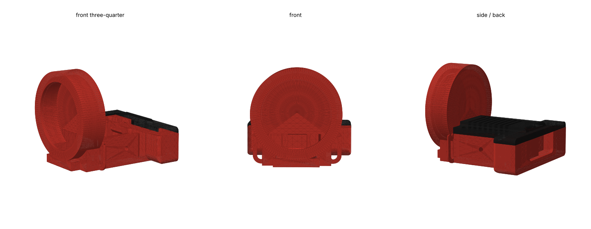

# Round face

Replaces the stock 0.91" OLED head with a **1.28" round TFT** (GC9A01, 240×240, Waveshare "1.28inch LCD Module" or a pin-compatible board). Two printed parts, `HeadRound` and `HatRound`, swap 1:1 for stock `Head` and `Hat`. Everything else on the robot is unchanged.



> **Status: mechanical only.** The stock firmware drives the SSD1306 OLED over I2C and does not know about this display. Printing this head gives you a screen with nothing on it until the GC9A01 driver and a face renderer are added to the firmware (SPI: SCK, MOSI, DC, CS, RST, BL on free ESP32-C3-Zero pins GP6–GP9, GP20, GP21). Track that work before you commit to the print.

## What changed

- The stock `Head` mesh is kept whole except for the OLED front wall (everything in front of x = −18.5 mm in the print frame). The pitch-servo pocket, neck-yoke pins, cable clips and hat seat are the untouched stock geometry.
- A Ø43.5 × 12.5 mm round housing is grafted on the front, face centre 17 mm above the pitch axis. Overall head: 53 × 47 × 46.75 mm (stock: 53 × 48 × 19.6).
- The display module slides in from the back of the housing: 1.4 mm bezel with a Ø33.5 window, Ø38.1 pocket with two 0.5 mm crush ribs for a friction fit, slot at the bottom for the connector tab. The PH2.0 connector sits in the cable passage into the box; the ribbon exits the back of the head with the servo lead.
- `HatRound` is the stock `Hat` trimmed 7.8 mm at the front to clear the housing, with one new M2 hole at head (−14, −12.9). `HeadRound` has the matching boss. The second hat screw is the stock one.

## Parts

| Role | File | Replaces |
| --- | --- | --- |
| Head + display housing | `HeadRound` | `Head` |
| Lid | `HatRound` | `Hat` |

`parts/sg90/` only. The housing geometry is servo-independent, but the stock head differs per servo preset, so other presets need a regenerate (see Regenerating).

## Display module

Designed around the Waveshare 1.28inch LCD Module: Ø37.5 mm PCB with a 2.9 mm connector tab (40.4 × 37.5 outline), Ø32.4 active area, PH2.0 8-pin connector on the back. Assumed display + PCB stack 3.4 mm, connector 6.8 mm tall. A different GC9A01 board (the square 37 × 37 mm ones are common) needs new pocket geometry; measure it and change `R_PCB`, `TAB_W`, `TAB_R`, `POCKET_D` in the build script.

## Print

- Same orientation as stock `Head`: floor down, open top. PLA or PETG, 3 walls, 20 % infill.
- Supports on. The display pocket is a Ø38 horizontal bore and the rear wings overhang; tree supports touching the build plate and model work.
- `HatRound` prints flat like stock.

## Assembly

Follow [docs/3d/assembly.md](../../docs/3d/assembly.md) §1 and §4 for the servo and neck join; they are identical. For the display:

1. Plug the display's cable in first (PH2.0 side), then slide the module into the housing from inside the box, tab down, until it seats against the bezel. The crush ribs hold it; a dab of hot glue at the tab is optional.
2. Lay the connector in the passage at the bottom of the housing and route the ribbon out the back with the servo lead.
3. Fit `HatRound` with two M2×8: stock hole at the rear, new hole at the front right.

## Calibration note

The face hangs 28 mm in front of the pitch axis, about 7 mm lower than the stock head at full nod. Start with the HEAD servo minimum at ~70° (stock 60°) in the web UI and open it up once you have checked clearance to the chest.

## Regenerating

`3d_models/cad/build_round_face.py` rebuilds both exports from the stock meshes with trimesh + manifold3d:

```bash
pip install trimesh manifold3d numpy
python3 mods/round-face/3d_models/cad/build_round_face.py 3d_models/parts/sg90/3mf mods/round-face/3d_models/parts/sg90/stl
```

There is no Fusion source for this mod; the script is the parametric source. Section check of the module and hat fit: `round_face_sections.png`.

## License

`3d_models/{cad,parts}/` are CERN-OHL-S-2.0, derived from the stock `Head` and `Hat`; see [`3d_models/NOTICE`](3d_models/NOTICE). This README is MIT like the rest of the docs.
